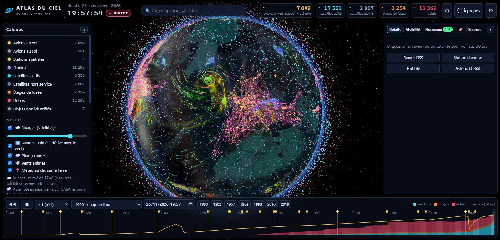

<div align="center">

# 🌍 Atlas du Ciel

**Les avions du monde entier, tous les objets spatiaux depuis 1957 et la météo en direct,<br>sur un globe 3D dans votre navigateur, de 1900 à aujourd'hui.**

[**▶ Voir le site en ligne**](https://damballah.github.io/atlas/) · [Installer le vôtre](#-installer-votre-propre-atlas-du-ciel) · [Licence MIT](LICENSE)

<!-- IMAGE PRINCIPALE : déposez une capture du globe dans docs/images/apercu.png (1600×900 conseillé) -->


*Idée et conception : **[Damballah](https://github.com/damballah)** · Programmation et documentation : **Claude** (Anthropic)*

</div>

<!-- GALERIE : déposez vos captures dans docs/images/ avec ces noms (ou changez les noms ci-dessous) -->
| Avions en temps réel | Satellites et débris | Voyage dans le temps |
|:---:|:---:|:---:|
|  |  |  |
| **Nuages, pluie et vents** | **Météo et climat d'un lieu** | **Prochains lancements** |
|  |  |  |
| **Recherche d'un vol** | **Passages au-dessus de chez vous** | **Zoom jusqu'aux villes** |
|  |  |  |

---

## ✨ Ce que ça fait

### Dans le ciel
- ✈️ **Tous les avions du monde** (7 000 à 12 000 selon l'heure), orientés selon leur vrai cap. Vus de loin, chacun rejoue en accéléré ses ~45 dernières minutes de vol réel ; de près, ils avancent à leur vraie vitesse.
- 🛰️ **Plus de 30 000 objets spatiaux** : satellites actifs, Starlink, stations, étages de fusée et débris, avec leurs orbites.
- ⏳ **Voyage dans le temps de 1900 à aujourd'hui** : le ciel vide, Spoutnik, la Lune, l'explosion de Starlink… avec les grandes dates sur une frise. Les nouveaux lancements s'ajoutent tout seuls.
- 🔍 **Recherche** d'un vol (`AFR1234`), d'une compagnie (« air france ») ou d'un satellite (« ISS ») : un clic n'affiche plus que cet objet.
- 👁️ **Visibilité** : à partir de votre adresse, les prochains passages de l'ISS (ou d'un autre satellite) visibles à l'œil nu, avec l'heure et la direction où regarder.

### La météo
- ☁️ **Les vrais nuages** vus par les satellites météo, animés selon le vent, avec la **pluie** et les **orages**, et des **vents animés** en particules. La frise remonte 72 heures en arrière.
- 📍 **Un clic sur la Terre** : la météo du lieu, les prochaines heures, et un **graphique des températures depuis 1940** (1 mois, 1 an, 10 ans, ou tout l'historique, avec les écarts à la normale).

### Et aussi
- 🚀 **Prochains lancements de fusées** : compte à rebours, pas de tir sur le globe, et retransmission en direct dans le site.
- 🎧 **Écouter** : la tour de contrôle de l'aéroport d'un avion (LiveATC.net), le direct de la NASA depuis l'ISS.
- 🔎 **Zoom net jusqu'aux villes** : en s'approchant, le globe se couvre d'images satellites de plus en plus détaillées (Sentinel-2 à 10 m, ou Esri jusqu'à 1 m).
- 🆓 **100 % gratuit et 100 % GitHub** : aucun serveur à louer, aucun ordinateur à laisser allumé.

---

## 🧭 Comment ça marche

```
                 cron-job.org (gratuit) « appuie sur le bouton » à heure fixe
                                       │
            ┌───────────────── GitHub Actions (gratuit) ───────────────┐
 OpenSky ──►│ « Atlas - avions »      toutes les 5 min                 │──► branche atlas-avions  ─┐
CelesTrak ─►│ « Atlas - satellites »  toutes les 3 h                   │──► branche atlas-donnees ─┤
 EUMETSAT,  │                                                          │                           │
 NASA, NOAA►│ « Atlas - météo »       toutes les heures                │──► branche atlas-meteo   ─┤
 Space Devs►│   (+ prochains lancements)                               │                           │
            └──────────────────────────────────────────────────────────┘                           ▼
                                   votre navigateur  ◄──  site votre-pseudo.github.io/atlas (GitHub Pages)
```

Un site GitHub Pages ne peut pas tout faire seul : OpenSky refuse les appels venant directement d'une page web, et les images météo doivent être assemblées en une carte du monde. Ce sont donc **trois tâches GitHub** qui vont chercher les données et les déposent sur trois branches du dépôt ; le site n'a plus qu'à les lire. Chaque branche ne garde qu'un seul commit, remplacé à chaque relevé : le dépôt ne grossit pas.

Le planificateur intégré de GitHub est **peu fiable** (il lui arrive de ne jamais lancer les tâches). Le service gratuit **cron-job.org** les déclenche donc à sa place, à heure fixe.

---

## 🚀 Installer votre propre Atlas du Ciel

> Il vous faut **un compte GitHub** et **un compte cron-job.org**, tous deux gratuits. Comptez **20 minutes**. Aucune ligne de commande.

### Étape 1 — Avoir un site GitHub Pages

Si vous avez déjà un dépôt nommé **`votre-pseudo.github.io`**, passez à l'étape 2.

Sinon, sur GitHub : bouton **＋** en haut à droite › **New repository**. Nom : **`votre-pseudo.github.io`** (avec votre vrai pseudo). Cochez **Public**, puis **Create repository**. GitHub le publiera à l'adresse `https://votre-pseudo.github.io`.

### Étape 2 — Télécharger Atlas du Ciel

Sur cette page : bouton vert **Code** › **Download ZIP**, puis dézippez-le.

### Étape 3 — Mettre votre pseudo dans le site

Ouvrez **`atlas/index.html`** avec le Bloc-notes. Cherchez les trois lignes qui contiennent **`damballah/damballah.github.io`** et remplacez **`damballah`** par **votre pseudo** (six fois en tout). Enregistrez.

```html
window.ATLAS_DONNEES = 'https://raw.githubusercontent.com/VOTRE-PSEUDO/VOTRE-PSEUDO.github.io/atlas-donnees/';
window.ATLAS_AVIONS  = 'https://raw.githubusercontent.com/VOTRE-PSEUDO/VOTRE-PSEUDO.github.io/atlas-avions/';
window.ATLAS_METEO   = 'https://raw.githubusercontent.com/VOTRE-PSEUDO/VOTRE-PSEUDO.github.io/atlas-meteo/';
```

### Étape 4 — Envoyer les fichiers

1. Dans votre dépôt sur GitHub : **Add file** › **Upload files**. Glissez le dossier **`atlas`**, puis **Commit changes**.
2. ⚠️ **Le dossier `.github` est souvent ignoré** quand on le glisse (son nom commence par un point). Créez-le à la main : **Add file** › **Create new file**, tapez comme nom `.github/workflows/test.yml`, écrivez une lettre dedans et **Commit**.
3. Ouvrez le dossier **`.github/workflows`** ainsi créé › **Add file** › **Upload files**, et glissez-y **les trois fichiers** `atlas-avions.yml`, `atlas-meteo.yml` et `atlas-satellites.yml` (les fichiers eux-mêmes, pas le dossier). **Commit changes**.
4. Supprimez le fichier `test.yml` (cliquez dessus › **⋯** › **Delete file** › **Commit**).

> 💡 Vous ne voyez pas le dossier `.github` sur votre PC ? Dans l'explorateur Windows : **Affichage › Éléments masqués**.

### Étape 5 — Autoriser les tâches automatiques

Dans votre dépôt : **Settings** › **Actions** › **General**.
1. En haut : **Allow all actions and reusable workflows**.
2. En bas, **Workflow permissions** : **Read and write permissions**.
3. **Save**.

### Étape 6 — Ajouter un compte OpenSky (conseillé, gratuit)

Sans compte, OpenSky peut limiter les relevés d'avions.
1. Créez un compte sur [opensky-network.org](https://opensky-network.org), puis **Account** › **API client** : créez un client et notez le **client_id** et le **client_secret**.
2. Dans votre dépôt : **Settings** › **Secrets and variables** › **Actions** › **New repository secret**.
3. Créez **`OPENSKY_CLIENT_ID`** (votre client_id), puis **`OPENSKY_CLIENT_SECRET`** (votre client_secret).

> 🔒 Les secrets ne sont jamais visibles, ni dans le site ni dans le dépôt.

### Étape 7 — Lancer les trois tâches une première fois

Onglet **Actions** de votre dépôt, puis pour chacune : cliquez son nom à gauche › **Run workflow** › **Run workflow**, et attendez la ✅.
1. **Atlas - satellites** (1 à 3 minutes)
2. **Atlas - avions** (moins d'une minute)
3. **Atlas - météo** (1 à 5 minutes)

Votre site fonctionne déjà : ouvrez **`https://votre-pseudo.github.io/atlas/`**. Il reste à le faire vivre tout seul.

### Étape 8 — Créer un jeton GitHub

Ce jeton permettra à cron-job.org de lancer vos tâches, **et rien d'autre**.
1. Sur GitHub : **votre photo** › **Settings** › **Developer settings** › **Personal access tokens** › **Fine-grained tokens** › **Generate new token**.
2. **Token name** : `cron atlas`. **Expiration** : 1 an (notez la date !).
3. **Repository access** : **Only select repositories** › `votre-pseudo.github.io`.
4. **Permissions** › **Repository permissions** › **Actions** : **Read and write**. Rien d'autre.
5. **Generate token**, puis copiez-le avec le bouton 📋 (il commence par `github_pat_`). Il ne sera **plus jamais affiché**.

> 🔒 Ne mettez jamais ce jeton dans un fichier du site ni sur une capture d'écran.

### Étape 9 — Programmer les relevés sur cron-job.org

1. Créez un compte gratuit sur [cron-job.org](https://cron-job.org) et validez l'e-mail.
2. **Create cronjob**. Onglet **Common** :
   - **Title** : `Atlas avions`
   - **URL** : `https://api.github.com/repos/VOTRE-PSEUDO/VOTRE-PSEUDO.github.io/actions/workflows/atlas-avions.yml/dispatches`
   - **Planning** : toutes les **5 minutes**
3. Onglet **Avancé** :
   - **Méthode de demande** : `POST`
   - **Corps de la demande** : `{"ref":"master"}` (ou `{"ref":"main"}` si votre branche principale s'appelle *main*)
   - Cliquez **Add Content-Type header now** s'il vous le propose.
   - Rubrique **En-têtes**, bouton **+ AJOUTER**, une ligne par en-tête (clé à gauche, valeur à droite) :

     | Clé | Valeur |
     |---|---|
     | `Accept` | `application/vnd.github+json` |
     | `Authorization` | `Bearer ` suivi de votre jeton (un espace entre les deux) |
     | `X-GitHub-Api-Version` | `2022-11-28` |
4. **Test de fonctionnement** : la réponse doit être **204** (voir le tableau des problèmes sinon), puis **Sauvegarder**.
5. **Clonez** cette tâche deux fois (menu **⋮** › Cloner) en changeant seulement le titre, le nom du fichier dans l'URL et le planning :
   - `Atlas météo` · `atlas-meteo.yml` · toutes les **heures**
   - `Atlas satellites` · `atlas-satellites.yml` · toutes les **3 heures**

### Étape 10 — Profiter 🎉

C'est fini : les avions se mettent à jour toutes les 5 minutes, la météo toutes les heures et les satellites toutes les 3 heures. L'historique météo se remplit tout seul (72 heures au bout de 3 jours). Le bouton **⚙** du site indique la date des derniers relevés.

> 📅 **Dans un an**, quand le jeton expire : sur GitHub, ouvrez le jeton `cron atlas` › **Regenerate token**, puis remplacez la valeur `Authorization` dans les trois tâches cron-job.org.

---

## 🆘 Problèmes fréquents

| Ce que vous voyez | Solution |
|---|---|
| **Rien ne bouge** (avions figés, nuages immobiles), message « positions datant de 300 min » | Les tâches ne tournent pas. Vérifiez l'onglet **Actions** (des lancements récents ?) et l'historique de cron-job.org (étape 9). |
| Plus aucune tâche dans l'onglet Actions | Le dossier `.github/workflows` a été vidé ou mal envoyé : refaites l'**étape 4**. |
| cron-job.org répond **401** | Jeton absent ou mal recopié : vérifiez `Authorization` = `Bearer github_pat_…` (avec un **z**, un espace, le jeton complet). |
| cron-job.org répond **403** | Il manque au jeton la permission **Actions : Read and write** (étape 8). |
| cron-job.org répond **404** | Faute dans l'URL : pseudo, nom du dépôt ou nom du fichier `.yml`. |
| cron-job.org répond **422** | Mauvaise branche dans le corps : essayez `{"ref":"main"}` au lieu de `master`. |
| ❌ croix rouge sur une tâche, avec « 403 » ou « Permission denied » | Refaites l'**étape 5** (Read and write permissions). |
| Le site s'affiche sans avion ni satellite | Refaites l'**étape 7**, puis vérifiez l'**étape 3** (votre pseudo dans `index.html`). |
| Pas de nuages, message « Météo pas encore publiée » | Lancez **Atlas - météo** et vérifiez la ligne `ATLAS_METEO` de l'étape 3. |
| Croix rouge sur **Atlas - météo** | Un service météo était en panne pendant ce relevé : le suivant, une heure plus tard, réessaie. Les relevés déjà publiés restent en ligne. |
| Message « CelesTrak en pause » | Normal : après un refus de CelesTrak, le site le laisse tranquille 24 h et utilise ses sources de secours. |
| Le site rame sur un vieux PC | Décochez **Vents animés**, et dans **⚙** mettez l'imagerie détaillée sur **Désactivée**. |

---

## 🎮 Utilisation

| Action | Souris / clavier |
|---|---|
| Tourner la Terre | clic gauche + glisser, ou flèches du clavier |
| Zoomer | molette, ou touches `+` / `-` |
| Déplacer la vue | clic droit + glisser |
| Plonger vers un point | double-clic |
| Fiche d'un avion ou d'un satellite | clic sur l'objet |
| Météo et climat d'un lieu | clic sur la Terre, là où il n'y a pas d'objet |
| Nuages, pluie, vents, animations | rubrique **Météo** du panneau de gauche |
| Prochains lancements | onglet **🚀** du panneau de droite |
| Suivre l'objet sélectionné | `F` |
| Pause / lecture du temps | `Espace` |
| Revenir au temps réel | `L` |
| Recentrer | `R` |
| Afficher / masquer une catégorie | clic sur les compteurs en haut (Ctrl + clic : n'afficher que celle-ci) |
| Crédits | bouton **ⓘ À propos** en haut à droite |

---

## 📁 Contenu du dépôt

```
atlas/
├── index.html            le site
├── main.js               le globe, les calculs d'orbite, la météo, l'interface
├── style.css             l'apparence
└── outils/               scripts utilisés par les tâches GitHub
    ├── avions.py         relevé mondial des avions
    ├── donnees.py        catalogue et orbites des satellites
    ├── meteo.py          cartes des nuages, de la pluie et des vents
    └── lancements.py     prochains lancements de fusées
.github/workflows/
├── atlas-avions.yml      tâche : avions
├── atlas-meteo.yml       tâche : météo et lancements
└── atlas-satellites.yml  tâche : satellites
```

Aucune installation ni compilation : le site est en HTML, CSS et JavaScript, avec [three.js](https://threejs.org) chargé depuis un CDN.

---

## 🤝 Respect des sources de données

- **CelesTrak** : un seul téléchargement par relevé, et une **pause de 24 h après tout refus**. Les visiteurs ne contactent jamais CelesTrak. Secours automatiques : **GCAT** et **SatNOGS**.
- **OpenSky** : un relevé mondial toutes les 5 minutes, soit environ 1 150 crédits par jour sur les 4 000 d'un compte gratuit.
- **Météo et lancements** : téléchargés par GitHub, pas par les visiteurs (2 appels par heure pour The Space Devs, qui en autorise 15). Seule la météo au clic interroge Open-Meteo depuis le navigateur, une fois par lieu cliqué.
- **LiveATC** : leurs flux audio ne sont pas intégrés au site, conformément à leurs conditions ; le site ouvre leur propre page.

## 📚 Sources et crédits

- Avions : [OpenSky Network](https://opensky-network.org), données ADS-B de récepteurs bénévoles. Fiches de vol : [adsbdb](https://www.adsbdb.com).
- Satellites : [CelesTrak](https://celestrak.org). Secours : data from GCAT (J. McDowell, [planet4589.org/space/gcat](https://planet4589.org/space/gcat)), licence CC BY, et [SatNOGS DB](https://db.satnogs.org), licence CC BY-SA 4.0.
- Nuages : © EUMETSAT ([EUMETView](https://view.eumetsat.int)) et NASA GIBS (GOES, Himawari). *We acknowledge the use of imagery provided by services from NASA's Global Imagery Browse Services (GIBS), part of NASA's Earth Science Data and Information System (ESDIS).*
- Pluie : NASA GPM IMERG via NASA GIBS (observations publiées avec environ 5 h de décalage). Vents : modèle [NOAA GFS](https://www.nco.ncep.noaa.gov/pmb/products/gfs/) (vent à 10 m, grille de 1°).
- Météo au clic et historique des températures : [Open-Meteo.com](https://open-meteo.com), licence CC BY 4.0 ; archives : réanalyse ERA5 de Copernicus / ECMWF (depuis 1940).
- Imagerie détaillée : Sentinel-2 cloudless 2024 – [s2maps.eu](https://s2maps.eu) by EOX IT Services GmbH (Contains modified Copernicus Sentinel data 2024), licence CC BY-NC-SA 4.0 (usage non commercial). Option : Esri World Imagery (© Esri, Maxar, Earthstar Geographics et la communauté des utilisateurs SIG).
- Lancements : [The Space Devs – Launch Library 2](https://thespacedevs.com/llapi). Retransmissions : chaînes officielles des opérateurs. Direct de l'ISS : NASA. Radio des avions : liens vers [LiveATC.net](https://www.liveatc.net).
- Adresses : [OpenStreetMap / Nominatim](https://nominatim.org) et la Géoplateforme de l'IGN.
- Moteur 3D : [three.js](https://threejs.org) (MIT). Textures de la Terre : NASA Blue Marble, via [three-globe](https://github.com/vasturiano/three-globe) (MIT).
- **Avions d'avant aujourd'hui** : une **simulation** fondée sur des ordres de grandeur historiques, car aucune archive mondiale de tous les vols n'existe. C'est indiqué clairement dans le site.

---

## 👥 Auteurs

| | |
|---|---|
| 💡 **Idée et conception** | **[Damballah](https://github.com/damballah)** : le projet, les fonctionnalités, les choix et les essais |
| 🤖 **Programmation et documentation** | **Claude** (Anthropic) : le code du site, les calculs d'orbite, les tâches automatiques et cette documentation, à partir des idées et des retours de Damballah |

---

## 📄 Licence

Le **code** d'Atlas du Ciel est distribué sous **licence MIT** : vous pouvez l'utiliser, le copier, le modifier et le redistribuer librement, y compris dans un projet commercial, à condition de conserver la mention de copyright et le texte de la licence. Voir le fichier [LICENSE](LICENSE).

Les **données** affichées (avions, satellites, météo, images, adresses) ne sont pas couvertes par cette licence : elles restent soumises aux conditions de leurs fournisseurs, listés ci-dessus. Certaines, comme l'imagerie Sentinel-2 d'EOX, n'autorisent qu'un usage non commercial.

<div align="center">

Conçu par [**Damballah**](https://github.com/damballah) · programmé avec **Claude**

</div>
